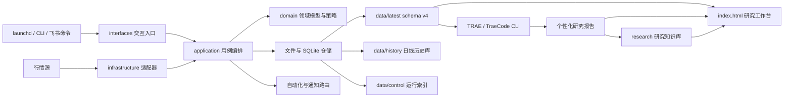
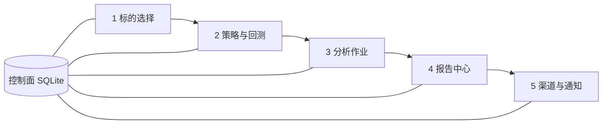
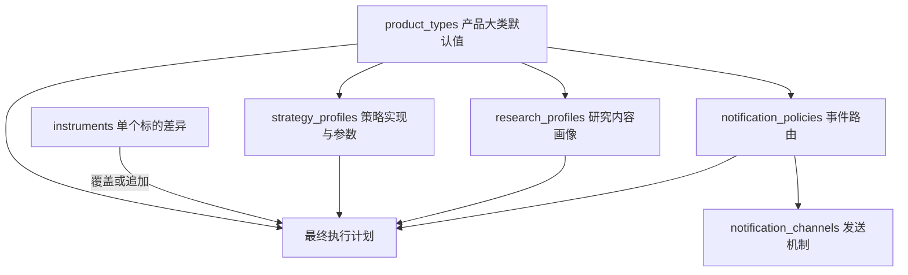
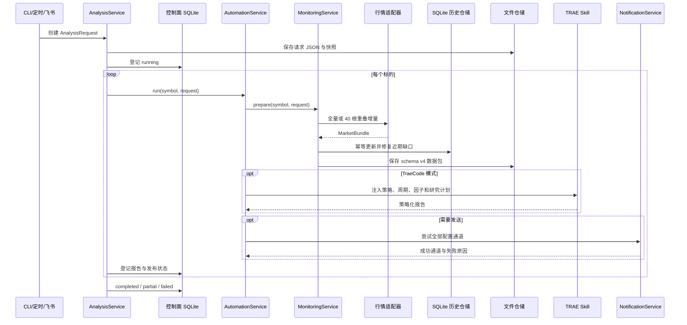

# 系统架构

## 总览

项目采用模块化单体。它保持本地运行和单命令运维，同时通过协议、注册表和分层配置支持 ETF、股票、指数以及不同研究与通知方式。



依赖只能从外向内。领域层不知道 HTTP、TOML、文件路径、飞书或 TRAE 的存在。

## 平台业务架构

平台不是按文件类型组织，而是按用户完成一次投资研究的五个阶段组织：



- **标的选择**：短期或长期候选池、证据缺口、筛选历史和短名单。
- **策略与回测**：策略版本、生命周期、配置指纹、验证状态和回测结果。
- **分析作业**：人工、定时和飞书共用一个标准请求。
- **报告中心**：按标的、策略、周期、因子、时间和发布状态归档。
- **渠道与通知**：网页负责可浏览资产，飞书负责固定命令和报告发送。

`data/control/research.sqlite3` 只保存运行事实和文件索引；配置、策略定义、
历史行情和报告正文仍由各自事实源管理，避免建立重复真相。

## 行为配置模型

项目不把“ETF 都一样”或“同类标的都一样”写死，而是使用四类可复用画像和单标的覆盖。



### 产品大类

`product_types.<type>` 定义默认策略画像、研究画像、通知策略和历史窗口。它表达
ETF、股票、指数等类别的共性，不保存单个代码的特殊要求。单个标的可用
`history_start_date` 声明应覆盖的首个交易日；历史同步发现本地首日晚于该日期时
执行全量回补，补齐后恢复重叠增量更新。

### 策略画像

`strategy_profiles.<id>` 绑定代码中的稳定 `strategy_id` 和少量业务阈值。产品大类或标的引用画像，因此同一算法可以有不同参数组合；评分结构等稳定实现仍留在代码和测试中。

一个标的可以引用多个策略画像。程序独立输出多个 assessment，不对冲突评分做没有依据的平均。

### 策略版本事实源

`config/config.toml` 保存标的最终引用和算法参数，
`research/strategies/catalog.toml` 保存策略版本生命周期。启用策略通过
`parameters_fingerprint` 绑定两者；指纹不一致、缺少启用版本或同标的同画像
存在多个启用版本时，分析、回测和页面刷新都会拒绝继续。

```text
draft -> active -> retired
          |
          +-> pending / passed / failed（验证状态）
```

单次回测不会自动修改验证状态。启用和验证是两个正交维度，历史版本不覆盖写。

### 研究画像

`research_profiles.<id>` 定义：

- 使用哪个研究 Skill。
- 报告章节和关注项。
- 来源优先级与来源数量上限。
- 对表达和分析方法的约束。

单个标的通过 `research_focus` 和 `research_instructions` 追加独有需求，也可以直接覆盖为专属研究画像。

### 通知策略与通道

`notification_policies.<id>` 定义哪些业务事件发送到哪些通道，以及标题模板。`notification_channels.<id>` 定义飞书等实际机制和凭证入口。

这种分离允许同类产品使用不同推送频率、目标和方式，也允许一个通道被多个策略复用。应用层只发送业务事件，不直接选择飞书。

## 候选发现与标的选择

单标的研究之前增加独立选择链路，避免把“已经配置的标的”误当成天然最优候选：


- 候选池是研究输入，不要求候选先进入正式监控配置。
- `SelectionService` 只负责历史指标、硬门槛和失败隔离。
- 费率、规模、跟踪误差、指数规则和成分暴露由 Skill 从带日期来源补齐。
- `market_score` 只比较流动性、近期波动和一年最大回撤，不是最终适配性评分。
- 数据源缺字段记为证据缺口；只有已知值违反门槛时才淘汰。
- 最终短名单仍需人工确认，系统不自动修改正式标的配置或执行交易。

## 一次标准分析作业的数据流



报告生成与渠道发布分别记账。飞书失败不会抹掉已经生成的报告；多通道发送会继续
尝试剩余通道，并在报告中心显示 `sent`、`partial`、`failed` 或
`not_requested`。

## 无人值守自动化

`AutomationService` 提供两个运行模式：

- `base`：直接调用 `MonitoringService`、基础报告渲染和通知服务。
- `traecli`：使用 TraeCode CLI 官方非交互 `-p` 模式执行项目命令
  `/instrument-analyze <symbol> <analysis-request-path>`。

当 `traecli` 二进制不存在且 `fallback_to_base = true` 时，任务降级为
`base`。如果 Agent 已经启动但返回失败，不再自动发送基础报告，避免一次任务产生重复消息。

工作日 LaunchAgent 调用 `./quant automate --all`。执行时间读取
`app.report_time`，是否发送由 `[automation]` 决定。

macOS 服务不直接运行 Documents 等受隐私保护目录内的开发仓库。安装脚本会将
最小运行副本和 `0600` 本机配置同步到 `~/.local/share/quant-monitor`，
LaunchAgent 只访问该目录；重新安装负责同步新版本，运行数据继续保留。

## 飞书远程命令

远程入口使用 `lark-cli event +subscribe` 建立 Bot WebSocket 长连接，只订阅
`im.message.receive_v1`。交互层依次执行：

1. 消息去重。
2. 发送人或群聊白名单校验。
3. 命令前缀与固定参数校验。
4. 调用监控或自动化应用服务。
5. 通过 lark-cli 回复原消息。

支持的命令固定为 `status`、`strategies`、`analyze`、`base`、`prepare`、
`dashboard` 和 `help`。`analyze` 支持单个或全部标的及日、月、年、均线周期。
飞书不提供耗时的标的选择入口，远程文本不会进入 Shell。

## schema v4 数据契约

```text
as_of              带时区采集时间
instrument         身份和最终解析后的画像引用
strategy_plan      当前启用策略版本、状态、指纹和回测绑定
analysis_plan      请求 ID、触发入口、周期、因子、模式和发送要求
quote              当前行情快照
metrics            与策略无关的确定性指标
assessments        各策略画像独立给出的基线判断
research_plan      最终研究章节、关注点、来源与指令
notification_plan  无敏感信息的事件和通道路由摘要
portfolio          可选持仓上下文
data_quality       来源、样本量、时间戳和限制
```

新数据只生成 v4；基础报告读取端兼容 v3。`data/latest` 是最终执行计划的运行
产物，不是配置源。修改行为应编辑 TOML 配置或策略目录并重新运行，不要手改
JSON。

## 历史数据与回测边界

每次行情采集成功后，`MonitoringService` 通过 `MarketHistoryRepository`
把标准化日线写入 `data/history/market.sqlite3`。SQLite 负责日期范围查询、
去重和事务；schema v4 JSON 快照继续负责还原单次研究任务，两者职责不同。

历史库 schema v2 保存前复权日线、指数估值、来源和采集时间。行情首次、条数
不足或陈旧超过 12 天时请求完整窗口；正常任务只请求最多 40 根重叠日线，既补充
新交易日，也修复近期缺口。指数估值按“指数代码 + 事实日期 + 指标 + 加权口径 +
历史窗口”幂等更新；降级行情源缺少成交额或换手率时，不用零值覆盖已有非零字段。

回测领域模型位于 `domain/backtesting/`，应用执行器位于
`application/backtesting.py`：

- `BacktestSpecification` 冻结模型版本、参数指纹、区间、成本、滑点和基准。
- `AttentionScoreAllocationModel` 把关注度显式映射为仅供验证的目标仓位。
- `DividendYieldPercentileAllocationModel` 消费来源逐日提供的时点分位，以
  242 日回撤确认增配，并按 20 个交易日间隔保持目标仓位。
- `BacktestResult` 约束权益曲线、指标和限制说明。
- 每个交易日只使用前一交易日及更早数据生成信号，在下一交易日开盘执行。
- 结果包含佣金、滑点、基准、超额收益、回撤、波动、换手和交易次数。

`dividend_yield_dynamic` 仍是未启用的估值策略草案。000151 最近三年的逐日
市值加权股息率、时点分位和分位线已写入历史库，510720 可执行有限基线回测。
基本面门禁暂以指数连续分红和支付率选样规则代理，不等于逐日财务回放；估值
缺失、历史少于 726 个观察值或数据陈旧时仍拒绝运行。不得用价格跌幅、ETF
当期现金分红或事后财务数据替代历史股息率。

当前没有参数优化、严格样本外评估、涨跌停、停牌、分红再投资和申赎冲击模型。
`AnalysisStrategy` 仍只表达研究关注度，目标仓位映射不进入线上自动交易。

## 研究知识库

`research/` 保存人与 Agent 讨论后的整理结果，不复制运行数据：

- `research/private/`：具体标的、持仓和个人计划，在当前私有仓库中同步。
- `research/library/`：经过复核与脱敏的跨标的经验，可随代码版本管理。
- `research/methods/`：数据、策略和回测方法的 HTML 报告。
- `research/universes/`：候选池、硬门槛、低频事实和来源日期。
- `research/selections/`：唯一的候选选择 HTML 报告；程序筛选 JSON 作为内部阶段输入。
- `research/strategies/`：策略生命周期、参数指纹和回测模型绑定。

研究记录必须区分事实和推断，并包含数据时间、来源、反例、风险和失效条件。

## 统一可视化入口

HTTP 根路径 `index.html` 是唯一网页导航入口。顶部只保留返回工作台；
五个业务模块、投资看板、研究归档和低频工程 Markdown 都由工作台分类进入。
`interfaces.portal` 只扫描面向人的研究 HTML，不把工程 HTML 副本、TOML、
原始 JSON、SQLite、日志、配置和凭证混入投资内容。

标的报告以 Markdown 作为通知源，`./quant site` 生成同目录同名 HTML，
并预留图表挂载区；工程 Markdown 则通过 `docs/markdown.html` 低频阅读。
`./quant site` 同时刷新工作台、模块页、报告 HTML 和全部页面的单一返回路径，
不引入第二份业务状态。

## TRAE 与 TraeCode CLI

- `.trae/skills/instrument-analyst` 是产品无关的研究执行器。
- `.trae/commands/instrument-analyze.md` 是标准分析作业入口。
- `.trae/commands/instrument-daily.md` 是 TRAE 项目命令入口。
- `.traecli/commands/instrument-analyze.md` 是 TraeCode CLI 的同语义适配器。

命令和 Skill 不再硬编码 ETF 内容。它们以 `strategy_plan`、`analysis_plan`、
`research_plan` 和 `notification_plan` 为准。

## 核心边界

| 边界 | 当前实现 | 扩展方式 |
|---|---|---|
| 投资标的 | ETF、股票、指数统一模型 | 扩展 `InstrumentType` |
| 行情入口 | 东方财富失败后降级腾讯 | 实现 `MarketDataProvider` |
| 候选选择 | TOML 候选池 + 硬门槛 + Skill 补证 | 扩展候选数据源和产品方法 |
| 通用指标 | 收益、均线、回撤、波动、流动性 | 新增纯计算模块 |
| 策略 | `strategies/etf|stock|index` 产品子包 | 新增独立模块并注册 `AnalysisStrategy` |
| 回测 | 冻结输入、目标仓位执行、成本、基准与 HTML | 新增模型和严格样本外评估 |
| 研究 | schema 驱动的通用 Skill | 新增研究画像或专用 Skill |
| 通知 | 事件策略 + 飞书通道 | 实现 `NotificationChannel` |
| 存储 | 原子文件 + 日线 SQLite + 控制面 SQLite | 实现对应仓储协议 |
| Agent | TraeCode CLI 非交互模式 | 实现 `ResearchAgentRunner` |
| 入口 | CLI、launchd、TRAE、飞书 | 调用应用用例，禁止复制业务 |

## 技术决策

### 模块化单体而非服务化

当前数据量和并发不足以抵消服务化成本。协议边界允许未来替换行情、存储、通知或入口，而无需重写领域逻辑。

### SQLite 与 JSON 并用

JSON 对单次研究透明、可审计，但不适合跨年范围查询和回测取数。SQLite 是当前
日线历史主存储：无需服务进程，支持事务、索引和备份，复杂度适合个人中长线研究。
只有多设备并发写入、多人远程访问或分钟级海量数据出现后，才评估 PostgreSQL
或专用时序存储。

当前私有 Git 仓库同步 SQLite 主库、快照、报告、候选结果和私有研究；
WAL/SHM/JOURNAL、配置、日志和凭证仍保持设备本地。安装脚本只用仓库数据补齐
新设备，不覆盖运行目录已有的新数据。常驻服务的数据由主写设备通过
`scripts/sync_runtime_data.sh` 在线备份并导出到仓库；SQLite 不做 Git 自动
合并，多设备必须执行单写者交接。接管设备只有在确认本地没有未同步产物后，
才能使用 `QUANT_RUNTIME_DATA_MODE=replace` 以仓库数据覆盖运行副本。

### 策略、研究和通知相互独立

策略回答“确定性规则怎么看”，研究画像回答“还需要了解什么”，通知策略回答“什么事件发到哪里”。三者可独立复用和覆盖，避免单个大配置对象或产品专用分支。

### 远程入口不开放 Shell

未来飞书或 HTTP 命令必须映射为经过认证的白名单应用事件，并记录审计信息。任何外部输入都不能直接成为 Shell。

## 演进触发条件

- 标的和跨年数据增长：继续使用 SQLite，增加索引、质量检查和增量同步。
- 多设备同时写入或多人远程访问：评估 PostgreSQL 与单写者服务。
- 分钟级海量行情：重新评估分区、列式文件或时序存储。
- 开放外网访问：先实现认证、授权、审计和限流。
- 策略影响真实资金动作：增加回测、版本冻结、审批和人工确认。
- 通知通道增加：拆分 `infrastructure/notifications` 为独立适配器包。
