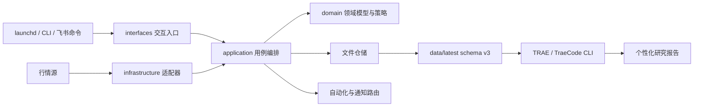
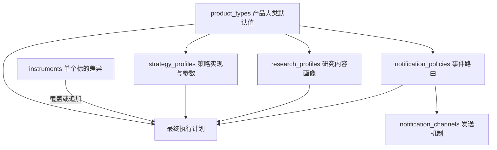
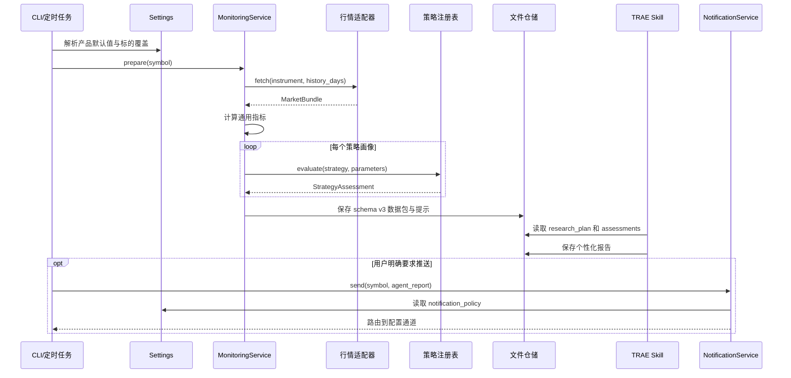

# 系统架构

## 总览

项目采用模块化单体。它保持本地运行和单命令运维，同时通过协议、注册表和分层配置支持 ETF、股票、指数以及不同研究与通知方式。



依赖只能从外向内。领域层不知道 HTTP、TOML、文件路径、飞书或 TRAE 的存在。

## 行为配置模型

项目不把“ETF 都一样”或“同类标的都一样”写死，而是使用四类可复用画像和单标的覆盖。



### 产品大类

`product_types.<type>` 定义默认策略画像、研究画像、通知策略和历史窗口。它表达 ETF、股票、指数等类别的共性，不保存单个代码的特殊要求。

### 策略画像

`strategy_profiles.<id>` 绑定代码中的稳定 `strategy_id` 和少量业务阈值。产品大类或标的引用画像，因此同一算法可以有不同参数组合；评分结构等稳定实现仍留在代码和测试中。

一个标的可以引用多个策略画像。程序独立输出多个 assessment，不对冲突评分做没有依据的平均。

### 研究画像

`research_profiles.<id>` 定义：

- 使用哪个研究 Skill。
- 报告章节和关注项。
- 来源优先级与来源数量上限。
- 对表达和分析方法的约束。

单个标的通过 `research_focus` 和 `research_instructions` 追加独有需求，也可以直接覆盖为专属研究画像。

### 通知策略与通道

`notification_policies.<id>` 定义哪些业务事件发送到哪些通道，以及标题模板。`notification_channels.<id>` 定义飞书等实际机制和凭证入口。

这种分离允许同类产品使用不同推送频率、目标和方式，也允许一个通道被多个策略复用。应用层只发送业务事件，不直接选择飞书。

## 一次研究任务的数据流



## 无人值守自动化

`AutomationService` 提供两个运行模式：

- `base`：直接调用 `MonitoringService`、基础报告渲染和通知服务。
- `traecli`：使用 TraeCode CLI 官方非交互 `-p` 模式执行项目命令
  `/instrument-daily <symbol> [push]`。

当 `traecli` 二进制不存在且 `fallback_to_base = true` 时，任务降级为
`base`。如果 Agent 已经启动但返回失败，不再自动发送基础报告，避免一次任务产生重复消息。

工作日 LaunchAgent 调用 `./quant automate --all`。执行时间读取
`app.report_time`，是否发送由 `[automation]` 决定。

macOS 服务不直接运行 Documents 等受隐私保护目录内的开发仓库。安装脚本会将
最小运行副本和 `0600` 本机配置同步到 `~/.local/share/quant-monitor`，
LaunchAgent 只访问该目录；重新安装负责同步新版本，运行数据继续保留。

## 飞书远程命令

远程入口使用 `lark-cli event +subscribe` 建立 Bot WebSocket 长连接，只订阅
`im.message.receive_v1`。交互层依次执行：

1. 消息去重。
2. 发送人或群聊白名单校验。
3. 命令前缀与固定参数校验。
4. 调用监控或自动化应用服务。
5. 通过 lark-cli 回复原消息。

支持的命令固定为 `status`、`analyze`、`base`、`prepare`、
`dashboard` 和 `help`。远程文本不会进入 Shell。

## schema v3 数据契约

```text
as_of              带时区采集时间
instrument         身份和最终解析后的画像引用
quote              当前行情快照
metrics            与策略无关的确定性指标
assessments        各策略画像独立给出的基线判断
research_plan      最终研究章节、关注点、来源与指令
notification_plan  无敏感信息的事件和通道路由摘要
portfolio          可选持仓上下文
data_quality       来源、样本量、时间戳和限制
```

`data/latest` 是最终执行计划的运行产物，不是配置源。修改行为应编辑 TOML 配置并重新运行 `prepare`，不要手改 JSON。

## TRAE 与 TraeCode CLI

- `.trae/skills/instrument-analyst` 是产品无关的研究执行器。
- `.trae/commands/instrument-daily.md` 是 TRAE 项目命令入口。
- `.traecli/commands/instrument-daily.md` 是 TraeCode CLI 的同语义适配器。

命令和 Skill 不再硬编码 ETF 内容。它们以 `research_plan.skill`、`sections`、`focus`、`source_priorities` 和 `instructions` 为准；通知以 `notification_plan` 为准。

## 核心边界

| 边界 | 当前实现 | 扩展方式 |
|---|---|---|
| 投资标的 | ETF、股票、指数统一模型 | 扩展 `InstrumentType` |
| 行情入口 | 东方财富失败后降级腾讯 | 实现 `MarketDataProvider` |
| 通用指标 | 收益、均线、回撤、波动、流动性 | 新增纯计算模块 |
| 策略 | 红利低波观察策略 | 实现并注册 `AnalysisStrategy` |
| 研究 | schema 驱动的通用 Skill | 新增研究画像或专用 Skill |
| 通知 | 事件策略 + 飞书通道 | 实现 `NotificationChannel` |
| 存储 | 原子文件仓储 | 实现仓储协议 |
| Agent | TraeCode CLI 非交互模式 | 实现 `ResearchAgentRunner` |
| 入口 | CLI、launchd、TRAE、飞书 | 调用应用用例，禁止复制业务 |

## 技术决策

### 模块化单体而非服务化

当前数据量和并发不足以抵消服务化成本。协议边界允许未来替换行情、存储、通知或入口，而无需重写领域逻辑。

### 文件仓储而非立即引入数据库

少量日频标的使用 JSON 更透明、可审计、易备份。出现跨年查询、并发写入或大量图表需求后，再按指标评估 SQLite 或时序存储。

### 策略、研究和通知相互独立

策略回答“确定性规则怎么看”，研究画像回答“还需要了解什么”，通知策略回答“什么事件发到哪里”。三者可独立复用和覆盖，避免单个大配置对象或产品专用分支。

### 远程入口不开放 Shell

未来飞书或 HTTP 命令必须映射为经过认证的白名单应用事件，并记录审计信息。任何外部输入都不能直接成为 Shell。

## 演进触发条件

- 标的超过约 20 个或需要跨年图表：评估 SQLite。
- 多进程同时写入：引入事务存储或单写者队列。
- 开放外网访问：先实现认证、授权、审计和限流。
- 策略影响真实资金动作：增加回测、版本冻结、审批和人工确认。
- 通知通道增加：拆分 `infrastructure/notifications` 为独立适配器包。
